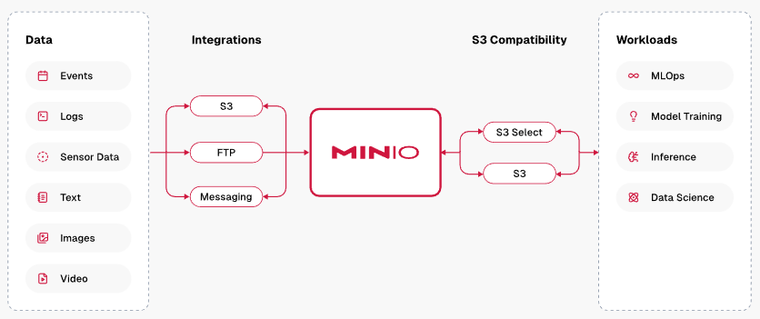

# MinIO AIStor Operator

[MinIO AIStor](https://www.min.io/product/aistor) is a software-defined, Amazon S3 compatible object store solution supporting AI workloads.

$ oc adm policy add-scc-to-user privileged system:serviceaccount:kube-system:px-csi
clusterrole.rbac.authorization.k8s.io/system:openshift:scc:privileged added: "px-csi"

## Commands

Command | Intent | Details
--- | --- | ---
iserver get ocp minio | check the minio operator state | [Link](./get.md)
iserver set ocp minio | install minio operator | [Link](./create_operator.md)
iserver set ocp task | in task way | [Link](./create_task.md)
iserver delete ocp minio | uninstall minio operator | [Link](./delete_operator.md)
iserver delete ocp task | in task way | [Link](./delete_task.md)

[[Back]](../Operations.md)