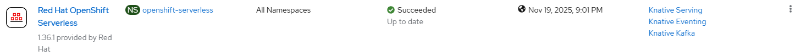

# Serverless - Create Operator

## Workflow

- create openshift-serverless namespace
- create operator group
- create subscription with user controlled channel or defaultChannelName
- wait for operator resources

## Requirements

None

## Expected outcome



## Configurable options

```
# iserver set ocp serverless --mode operator
  --cluster TEXT     Cluster Name
  --channel TEXT     Operator channel  [default: __default__]
  --no-confirm       Confirmation mode
```

## Example

```
# iserver set ocp serverless --mode operator --cluster bm1 --no-confirm

OpenShift Workflow - Serverless Operator - Create Operator
==========================================================

OpenShift Cluster: bm1
Subscription not found serverless-operator

Create Namespace
----------------
- name: openshift-serverless

~~~
apiVersion: v1
kind: Namespace
metadata:
  name: openshift-serverless
~~~
Namespace [openshift-serverless] created
Wait for namespace [timeout:60]...

Create OperatorGroup
--------------------
- namespace: openshift-serverless
- name: serverless-operator-group

~~~
apiVersion: operators.coreos.com/v1
kind: OperatorGroup
metadata:
  name: serverless-operator-group
  namespace: openshift-serverless
spec:
  upgradeStrategy: Default
~~~
OperatorGroup [openshift-serverless/serverless-operator-group] created
- wait for OperatorGroup openshift-serverless/serverless-operator-group [timeout:60s]

Create Subscription
-------------------
Subscription: openshift-serverless/serverless-operator
Source: openshift-marketplace/redhat-operators/serverless-operator
Install plan approval: Automatic
Getting subscription and packege manifest information...
Resolving channel name...
Channel: stable
- CSV [serverless-operator.v1.37.1]
- CSV Display name [Red Hat OpenShift Serverless]
- CVS Version [1.37.1]
- CSV Provider [{'name': 'Red Hat'}]
- CSV Maturity [stable]

~~~
apiVersion: operators.coreos.com/v1alpha1
kind: Subscription
metadata:
  name: serverless-operator
  namespace: openshift-serverless
spec:
  channel: stable
  installPlanApproval: Automatic
  name: serverless-operator
  source: redhat-operators
  sourceNamespace: openshift-marketplace
~~~

Subscription created

Wait for subscription install plan started [timeout:360]...
Install plan: install-jskgp
Wait for subscription install plan ready [timeout:600]...
Install plan succeeded
Wait for deployment openshift-serverless/knative-openshift ready (optional: False, allow zero replicas: False, timeout: 600s)...
Wait for deployment openshift-serverless/knative-openshift-ingress ready (optional: False, allow zero replicas: False, timeout: 600s)...
Wait for deployment openshift-serverless/knative-operator-webhook ready (optional: False, allow zero replicas: False, timeout: 600s)...
Subscription serverless ready

Operator
- subscription          : openshift-serverless/serverless-operator
- package               : openshift-marketplace/redhat-operators/serverless-operator
- channel               : stable
- install plan          : openshift-serverless/install-jskgp
- install plan approved : V
- installed csv         : serverless-operator.v1.37.1
- latest_csv            : V


Completed tasks
- Namespace created
- Operator Group created
- Subscription created

+----+---------+------------+-----------------+---------+---------+--------------+
| ID | Target  | Scope      | Workflow        | Changes | Success | Duration [s] |
+----+---------+------------+-----------------+---------+---------+--------------+
| 1  | ocp:bm1 | serverless | create operator | 3       | V       | 47           | 
+----+---------+------------+-----------------+---------+---------+--------------+
```

[[Back]](./README.md)