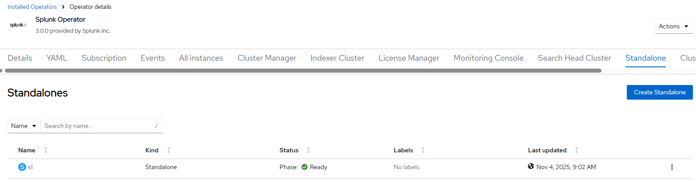
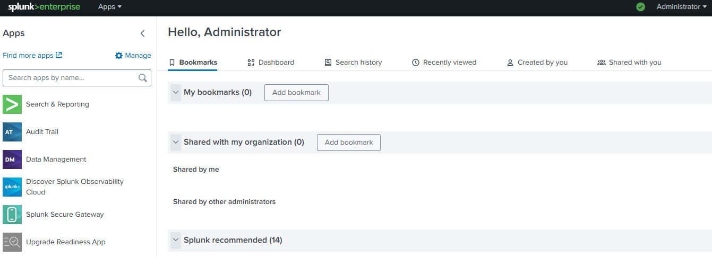

# Splunk - Create Standalone Instance

[[Back]](./README.md) [[kb]](./kb/standalone.md)

## Workflow

- create standalone splunk instance
- create route
- wait for instance resources ready

## Requirements

- Splunk operator [created](./create_operator.md)
- storage subsystem e.g. [LVM](../lvm/README.md), [ODF](../odf/README.md)
- default storage class used to create PVCs for splunk standalone instance

## Configurable options

- route is created by default
- use --no-route flag to disable route create

```
# iserver set ocp splunk --mode instance
  --cluster TEXT                  Cluster Name
  --instance TEXT                 Standalone instance name
  --no-route                      Instance route
  --no-confirm                    Confirmation mode
```

## Non-configurable defaults

```
{
    "namespace": "splunk-operator",
    "pvc-finalizers": true
}
```

## Expected outcome






## Example

```
# iserver set ocp splunk --mode instance --cluster bm1 --instance inst1 --no-confirm

OpenShift Workflow - Splunk Operator - Create Instance
======================================================

OpenShift Cluster: bm1

Create Standalone
-----------------
- namespace: splunk-operator
- name: inst1

~~~
apiVersion: enterprise.splunk.com/v4
kind: Standalone
metadata:
  finalizers:
  - enterprise.splunk.com/delete-pvc
  name: inst1
  namespace: splunk-operator
spec: {}
~~~
Standalone [splunk-operator/inst1] created
Wait until pod splunk-operator/splunk-inst1-standalone-0 is running [timeout:1800s]...
Wait for Standalone splunk-operator/inst1 [timeout:600s] with {"ready": true}

Create splunk instance route
----------------------------
- instance namespace: splunk-operator
- instance name: inst1
- service namespace: splunk-operator
- service name: splunk-inst1-standalone-service
- service found
- route namespace: splunk-operator
- route name: splunk-inst1-standalone-service

~~~
apiVersion: route.openshift.io/v1
kind: Route
metadata:
  labels:
    app.kubernetes.io/component: standalone
    app.kubernetes.io/instance: splunk-inst1-standalone
    app.kubernetes.io/managed-by: splunk-operator
    app.kubernetes.io/name: standalone
    app.kubernetes.io/part-of: splunk-inst1-standalone
  name: splunk-inst1-standalone-service
  namespace: splunk-operator
spec:
  host: splunk-inst1-standalone-service-splunk-operator.apps.bm1.domain.com
  port:
    targetPort: http-splunkweb
  to:
    kind: Service
    name: splunk-inst1-standalone-service
    weight: 100
  wildcardPolicy: null
~~~

Route created
Wait for Route splunk-operator/splunk-inst1-standalone-service [timeout:120s] with {"ready": true}

+----+-----------------+-------+-----+-----+---------+-------+----------------------------------------------------------------------------+
| ID | Standalone      | Ready | Pod | PVC | Service | Route | URL                                                                        |
+----+-----------------+-------+-----+-----+---------+-------+----------------------------------------------------------------------------+
| 1  | splunk-operator | V     | V   | 2/2 | V       | 1/1   | http://splunk-inst1-standalone-service-splunk-operator.apps.bm1.domain.com | 
|    | inst1           |       |     |     |         |       |                                                                            | 
+----+-----------------+-------+-----+-----+---------+-------+----------------------------------------------------------------------------+

Completed tasks
- Standalone instance created
- Route configured

+----+---------+--------+-----------------+---------+---------+--------------+
| ID | Target  | Scope  | Workflow        | Changes | Success | Duration [s] |
+----+---------+--------+-----------------+---------+---------+--------------+
| 1  | ocp:bm1 | splunk | create instance | 2       | V       | 74           | 
+----+---------+--------+-----------------+---------+---------+--------------+
```

[[Back]](./README.md) [[kb]](./kb/standalone.md)