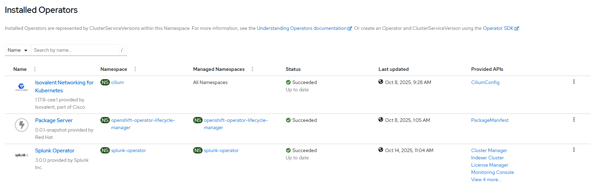

# Splunk - Create Operator

[[Back]](./README.md) [[kb]](./kb/operator.md)

## Workflow

- create splunk operator namespace 
- create operator group
- create subscription with user controlled channel or defaultChannelName
- wait for resources ready

## Requirements

None

## Configurable options

```
# iserver set ocp splunk --mode operator
  --cluster TEXT                  Cluster Name
  --channel TEXT                  Operator channel  [default: __default__]
  --no-confirm                    Confirmation mode
```

## Expected outcome



## Example

```
# iserver set ocp splunk --cluster --bm1 --mode operator --no-confirm

OpenShift Workflow - Splunk Operator - Create Operator
======================================================

OpenShift Cluster: bm1
Subscription not found splunk-operator

Create Namespace
----------------
- name: splunk-operator

~~~
apiVersion: v1
kind: Namespace
metadata:
  name: splunk-operator
~~~
Namespace [splunk-operator] created
Wait for namespace [timeout:60]...

Create OperatorGroup
--------------------
- namespace: splunk-operator
- name: splunk-operator-group

~~~
apiVersion: operators.coreos.com/v1
kind: OperatorGroup
metadata:
  name: splunk-operator-group
  namespace: splunk-operator
spec:
  targetNamespaces:
  - splunk-operator
  upgradeStrategy: Default
~~~
OperatorGroup [splunk-operator/splunk-operator-group] created
- wait for OperatorGroup splunk-operator/splunk-operator-group [timeout:60s]

Create Subscription
-------------------
Subscription: splunk-operator/splunk-operator
Source: openshift-marketplace/certified-operators/splunk-operator
Install plan approval: Automatic
Getting subscription and packege manifest information...
Resolving channel name...
Channel: stable
- CSV [splunk-operator.v3.1.0]
- CSV Display name [Splunk Operator]
- CVS Version [3.1.0]
- CSV Provider [{'name': 'Splunk Inc.', 'url': 'www.splunk.com'}]
- CSV Maturity [stable]

~~~
apiVersion: operators.coreos.com/v1alpha1
kind: Subscription
metadata:
  name: splunk-operator
  namespace: splunk-operator
spec:
  channel: stable
  installPlanApproval: Automatic
  name: splunk-operator
  source: certified-operators
  sourceNamespace: openshift-marketplace
~~~

Subscription created

Wait for subscription install plan started [timeout:360]...
Install plan: install-fbwcl
Wait for subscription install plan ready [timeout:600]...
Install plan succeeded
Wait for deployment splunk-operator/splunk-operator-controller-manager ready (optional: True, allow zero replicas: False, timeout: 600s)...

Operator
- subscription          : splunk-operator/splunk-operator
- package               : openshift-marketplace/certified-operators/splunk-operator
- channel               : stable
- install plan          : splunk-operator/install-fbwcl
- install plan approved : ✓
- installed csv         : splunk-operator.v3.1.0
- latest_csv            : ✓


Completed tasks
- Namespace created
- Operator Group created
- Subscription created

Set Splunk operator subscription license
- subscription package: splunk-operator
- subscription found
- csv splunk-operator/splunk-operator
- csv found
- set env SPLUNK_GENERAL_TERMS value to --accept-sgt-current-at-splunk-com
~~~
apiVersion: operators.coreos.com/v1alpha1
kind: ClusterServiceVersion
metadata:
  name: splunk-operator.v3.1.0
  namespace: splunk-operator
spec:
  ...
~~~
- csv patched
- delete deployment splunk-operator/splunk-operator-controller-manager
- wait for deployment ready

Set OpenShift policy for Splunk operator
- subscription package: splunk-operator
- subscription found
- csv splunk-operator/splunk-operator
- csv found

Create role binding
-------------------
- namespace: splunk-operator
- name: system:openshift:scc:nonroot-v2
- cluster role: system:openshift:scc:nonroot-v2
- service account namespace: splunk-operator
- service account name: default

~~~
apiVersion: rbac.authorization.k8s.io/v1
kind: RoleBinding
metadata:
  name: system:openshift:scc:nonroot-v2
  namespace: splunk-operator
roleRef:
  apiGroup: rbac.authorization.k8s.io
  kind: ClusterRole
  name: system:openshift:scc:nonroot-v2
subjects:
- kind: ServiceAccount
  name: default
  namespace: splunk-operator
~~~

Role binding created
- delete deployment splunk-operator/splunk-operator-controller-manager
- wait for deployment ready

+----+---------+--------+-----------------+---------+---------+--------------+
| ID | Target  | Scope  | Workflow        | Changes | Success | Duration [s] |
+----+---------+--------+-----------------+---------+---------+--------------+
| 1  | ocp:bm1 | splunk | create operator | 7       | ✓       | 82           | 
+----+---------+--------+-----------------+---------+---------+--------------+
```

[[Back]](./README.md) [[kb]](./kb/operator.md)