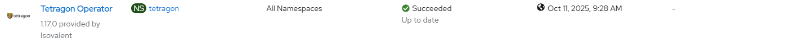

# Tetragon - Create Operator

## Workflow

- create tetragon namespace 
- create catalog source with user-defined image
- create operator group
- create subscription with user controlled channel or defaultChannelName

## Requirements

None

## Configurable options

```
# iserver set ocp tetragon --mode operator
  --cluster TEXT            Cluster Name
  --channel TEXT            Operator channel  [default: __default__]
  --image TEXT              Tetragon Enterprise Operator image
  --no-confirm              Confirmation mode
```

## Expected outcome



## Example

```
# iserver set ocp tetragon --mode operator --cluster bm1 --image image-name-as-provided-by-isovalent --no-confirm

OpenShift Workflow - Tetragon - Create Operator
===============================================

OpenShift Cluster: bm1

Create Namespace
----------------
- name: tetragon

~~~
apiVersion: v1
kind: Namespace
metadata:
  labels:
    openshift.io/user-monitoring: 'true'
  name: tetragon
~~~
Namespace [tetragon] created
Wait for namespace [timeout:60]...

Check labels
- openshift.io/user-monitoring:true found

Create CatalogSource
--------------------
- namespace: tetragon
- name: tetragon-catalog

~~~
apiVersion: operators.coreos.com/v1alpha1
kind: CatalogSource
metadata:
  name: tetragon-catalog
  namespace: tetragon
spec:
  ...
~~~
CatalogSource [tetragon/tetragon-catalog] created
- wait for CatalogSource tetragon/tetragon-catalog [timeout:60s]

Wait for tetragon package...
Tetragon package found

Create OperatorGroup
--------------------
- namespace: tetragon
- name: tetragon

~~~
apiVersion: operators.coreos.com/v1
kind: OperatorGroup
metadata:
  name: tetragon
  namespace: tetragon
spec:
  upgradeStrategy: Default
~~~
OperatorGroup [tetragon/tetragon] created
- wait for OperatorGroup tetragon/tetragon [timeout:60s]

Create Subscription
-------------------
Subscription: tetragon/tetragon-operator
Source: tetragon/tetragon-catalog/tetragon-operator
Install plan approval: Automatic
Getting subscription and packege manifest information...
Resolving channel name...
Channel: v1.18
- CSV [tetragon-operator.v1.18.2]
- CSV Display name [Tetragon Operator]
- CVS Version [1.18.2]
- CSV Provider [{'name': 'Isovalent', 'url': 'https://isovalent.com'}]
- CSV Maturity [alpha]

~~~
apiVersion: operators.coreos.com/v1alpha1
kind: Subscription
metadata:
  labels:
    operators.coreos.com/tetragon-operator.tetragon: ''
  name: tetragon-operator
  namespace: tetragon
spec:
  channel: v1.18
  installPlanApproval: Automatic
  name: tetragon-operator
  source: tetragon-catalog
  sourceNamespace: tetragon
~~~

Subscription created

Wait for subscription install plan started [timeout:360]...
Install plan: install-sd9g7
Wait for subscription install plan ready [timeout:600]...
Install plan succeeded
Wait for deployment tetragon/tetragon-operator ready (optional: False, allow zero replicas: False, timeout: 600s)...
Wait for daemonset tetragon/tetragon ready (optional: False, timeout: 600s)...
Subscription tetragon ready

Completed tasks
- Namespace created
- Operator Group created
- Tetragon Operator installed

+----+---------+----------+-----------------+---------+---------+--------------+
| ID | Target  | Scope    | Workflow        | Changes | Success | Duration [s] |
+----+---------+----------+-----------------+---------+---------+--------------+
| 1  | ocp:bm1 | tetragon | create operator | 4       | V       | 56           | 
+----+---------+----------+-----------------+---------+---------+--------------+
```

[[Back]](./README.md)