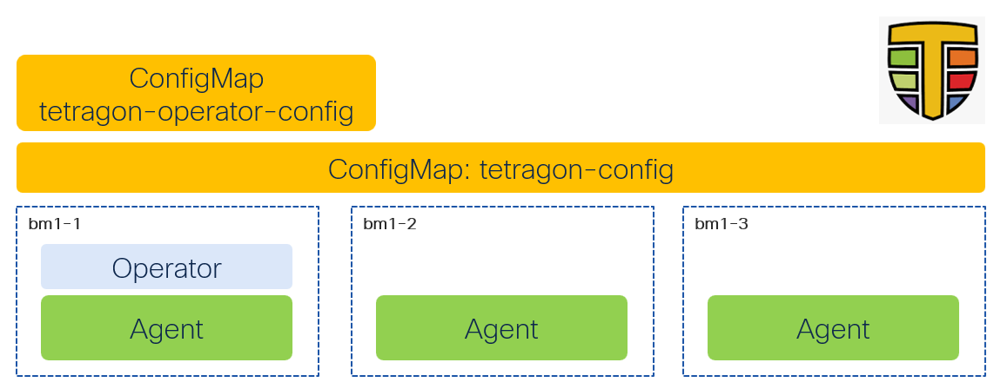

# Tetragon - Operator

[[Back]](../README.md)

Tetragon Enterprise in an OpenShift cluster is installed as operator with the Operator Lifecycle Manager (OLM) framework.



## Namespace

```yaml
apiVersion: v1
kind: Namespace
metadata:
  labels:
    openshift.io/user-monitoring: 'true'
  name: tetragon
```

## Catalog Source

Refer to official [documentation](https://docs.isovalent.com/iep/latest/tetragon/installation/openshift.html) for details.

```
kubectl create ns tetragon
kubectl create secret docker-registry isovalent-registry \
  --namespace tetragon \
  --docker-server=containers.isovalent.com \
  --docker-username=<username> \
  --docker-password=<password>

cat <<EOF | kubectl create -f -
apiVersion: operators.coreos.com/v1alpha1
kind: CatalogSource
metadata:
  name: tetragon-catalog
  namespace: tetragon
spec:
  sourceType: grpc
  image: containers.isovalent.com/tetragon-operator-index:v0.0.1
  secrets:
    - isovalent-registry
EOF
```

## Operator Group

```yaml
apiVersion: operators.coreos.com/v1
kind: OperatorGroup
metadata:
  name: tetragon
  namespace: tetragon
spec:
  upgradeStrategy: Default
```

## Subscription

```yaml
apiVersion: operators.coreos.com/v1alpha1
kind: Subscription
metadata:
  labels:
    operators.coreos.com/tetragon-operator.tetragon: ''
  name: tetragon-operator
  namespace: tetragon
spec:
  installPlanApproval: Automatic
  name: tetragon-operator
  source: tetragon-catalog
  sourceNamespace: tetragon
```

## Expected outcome


```
$ oc get all -n tetragon
Warning: apps.openshift.io/v1 DeploymentConfig is deprecated in v4.14+, unavailable in v4.10000+
NAME                                                                  READY   STATUS      RESTARTS      AGE
pod/tetragon-85mjh                                                    1/1     Running     2 (21m ago)   42m
pod/tetragon-catalog-ghkhc                                            1/1     Running     1             50m
pod/tetragon-operator-dd8d5848-2sxnc                                  1/1     Running     0             20m

NAME                       TYPE        CLUSTER-IP       EXTERNAL-IP   PORT(S)     AGE
service/tetragon-catalog   ClusterIP   172.30.178.247   <none>        50051/TCP   66m

NAME                      DESIRED   CURRENT   READY   UP-TO-DATE   AVAILABLE   NODE SELECTOR            AGE
daemonset.apps/tetragon   1         1         1       1            1           kubernetes.io/os=linux   42m

NAME                                READY   UP-TO-DATE   AVAILABLE   AGE
deployment.apps/tetragon-operator   1/1     1            1           44m

NAME                                          DESIRED   CURRENT   READY   AGE
replicaset.apps/tetragon-operator-6cfb585fd   0         0         0       44m
replicaset.apps/tetragon-operator-dd8d5848    1         1         1       20m
```

[[Back]](../README.md)