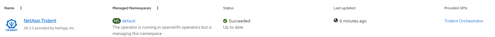

# Trident - Create Operator

[[Back]](./README.md)

## Workflow

- create subscription with user controlled channel or defaultChannelName
- wait for resources ready

## Requirements

None

## Configurable options

```
# iserver set ocp trident --mode operator
  --cluster TEXT                  Cluster Name
  --channel TEXT                  Operator channel  [default: __default__]
  --no-confirm                    Confirmation mode
```

## Expected outcome



## Example

```
# iserver set ocp trident --cluster bm1 --mode operator --no-confirm

OpenShift Workflow - Trident Operator - Create Operator
=======================================================

OpenShift Cluster: bm1
Subscription not found trident-operator

Create Namespace
----------------
- name: openshift-operators
- already created

Create Subscription
-------------------
Subscription: openshift-operators/trident-operator
Source: openshift-marketplace/certified-operators/trident-operator
Install plan approval: Automatic
Getting subscription and packege manifest information...
Resolving channel name...
Channel: stable
- CSV [trident-operator.v26.2.0]
- CSV Display name [NetApp Trident]
- CVS Version [26.2.0]
- CSV Provider [{'name': 'NetApp, Inc.', 'url': 'https://www.netapp.com/'}]

~~~
apiVersion: operators.coreos.com/v1alpha1
kind: Subscription
metadata:
  name: trident-operator
  namespace: openshift-operators
spec:
  channel: stable
  installPlanApproval: Automatic
  name: trident-operator
  source: certified-operators
  sourceNamespace: openshift-marketplace
~~~

Subscription created

Wait for subscription install plan started [timeout:360]...
Install plan: install-llppc
Wait for subscription install plan ready [timeout:600]...
Install plan succeeded
Wait for deployment openshift-operators/trident-operator ready (optional: False, allow zero replicas: False, timeout: 600s)...
Subscription trident ready

Operator
- subscription          : openshift-operators/trident-operator
- package               : openshift-marketplace/certified-operators/trident-operator
- channel               : stable
- install plan          : openshift-operators/install-llppc
- install plan approved : V
- installed csv         : trident-operator.v26.2.0
- latest_csv            : V


Completed tasks
- Namespace created
- Operator Group created
- Subscription created

+----+---------+---------+-----------------+---------+---------+--------------+
| ID | Target  | Scope   | Workflow        | Changes | Success | Duration [s] |
+----+---------+---------+-----------------+---------+---------+--------------+
| 1  | ocp:bm1 | trident | create operator | 1       | V       | 25           | 
+----+---------+---------+-----------------+---------+---------+--------------+
```

[[Back]](./README.md)